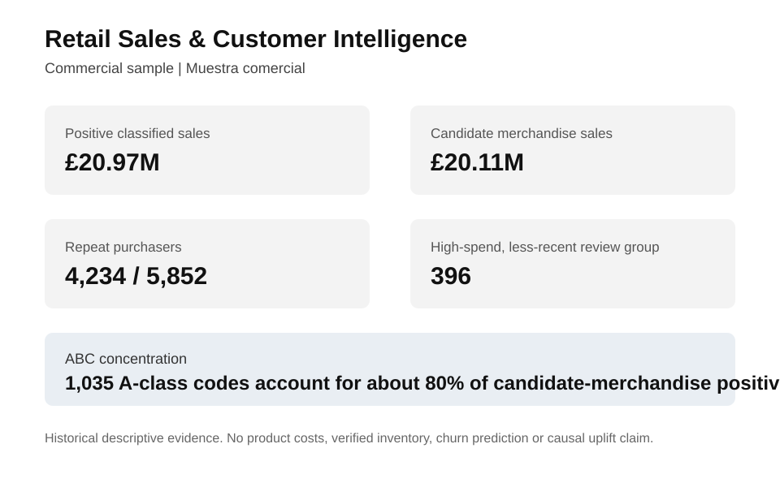

# Retail commercial intelligence sample | Muestra de inteligencia comercial retail

## English

**Supports:** F02 Commercial analysis, U09 Pareto and ABC classification, U11 Customer segmentation.

This sample summarizes a public historical analysis of Online Retail II. The case separates positive classified sales, candidate merchandise, repeat purchasing and an RFM review signal without turning descriptive patterns into unsupported profitability or churn claims.

Verified case results include **£20.97 million** in positive value on classified sale lines, **£20.11 million** assigned to merchandise-candidate codes, **1,035 A-class codes** representing approximately **80%** of candidate-merchandise positive sales, **4,234 repeat purchasers** among **5,852** identified candidate-merchandise customers, and **396 high-spend, less-recent customers** flagged for investigation.

**Example deliverable:** ABC concentration table, customer recurrence and RFM summary, prioritized review list, and a concise commercial interpretation.

**Main limit:** the source does not contain product costs or verified inventory. ABC is based on positive recorded sales, not profit. RFM describes historical behavior and is not a churn prediction.

**Source:** Chen, D. (2012), Online Retail II, UCI Machine Learning Repository, DOI 10.24432/C5CG6D, CC BY 4.0.

## Español

**Respalda:** F02 Análisis comercial, U09 Pareto y clasificación ABC, U11 Clientes y segmentación.

Esta muestra resume un análisis histórico público de Online Retail II. El caso separa ventas positivas clasificadas, mercancía candidata, recurrencia de compra y una señal de revisión RFM sin convertir patrones descriptivos en afirmaciones no sustentadas de rentabilidad o abandono.

Los resultados verificados incluyen **£20.97 millones** en valor positivo de líneas clasificadas como ventas, **£20.11 millones** asignados a códigos candidatos a mercancía, **1,035 códigos clase A** que representan aproximadamente **80 %** de las ventas positivas de mercancía candidata, **4,234 compradores recurrentes** entre **5,852** clientes identificados y **396 clientes de gasto alto y menor recencia** marcados para investigación.

**Ejemplo de entrega:** tabla de concentración ABC, resumen de recurrencia y RFM, lista priorizada de revisión e interpretación comercial breve.

**Límite principal:** la fuente no contiene costos de producto ni inventario verificado. ABC se basa en ventas positivas registradas, no en utilidad. RFM describe comportamiento histórico y no predice abandono.

**Fuente:** Chen, D. (2012), Online Retail II, UCI Machine Learning Repository, DOI 10.24432/C5CG6D, CC BY 4.0.

Carlos Segura
